# tinyrl

## tinyrl@Algorithms

tinyrl implements the following deep reinforcement learning algorithms:

* DDPG: ["Continuous control with deep reinforcement learning"](https://arxiv.org/abs/1509.02971) from Lillicrap et al., 2015

* TD3: ["Addressing Function Approximation Error in Actor-Critic Methods"](https://arxiv.org/abs/1802.09477) from Fujimoto et al., 2018

* SAC: ["Soft Actor-Critic: Off-Policy Maximum Entropy Deep Reinforcement Learning with a Stochastic Actor"](https://arxiv.org/abs/1801.01290) from Haaranoja et al., 2018

* PPO (TODO): [Proximal Policy Optimization](https://arxiv.org/abs/1707.06347) introduced from Schulman et al., 2017

* TD7 (TODO): ...

## tinyrl@MuJoCo

|    |    |    |    |    |    |
| -- | -- | -- | -- | -- | -- |
| 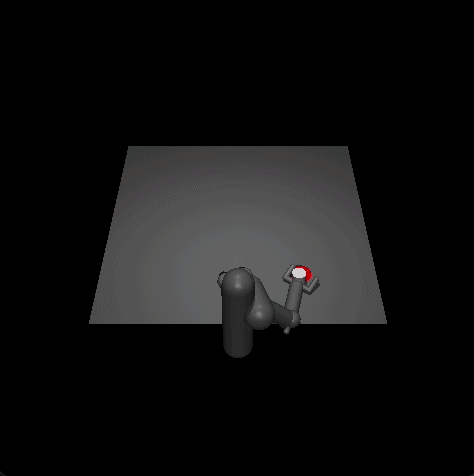 | 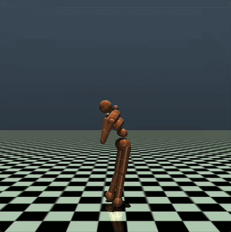 | 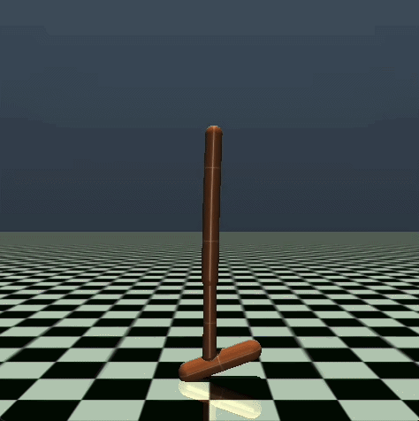 | 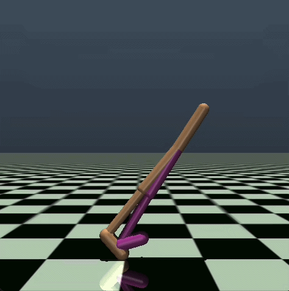 | 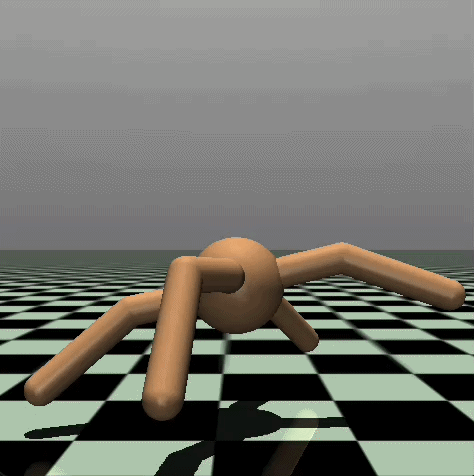 | 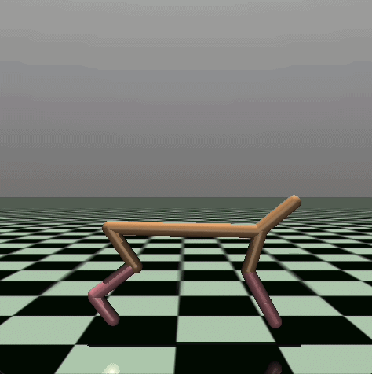 |
| 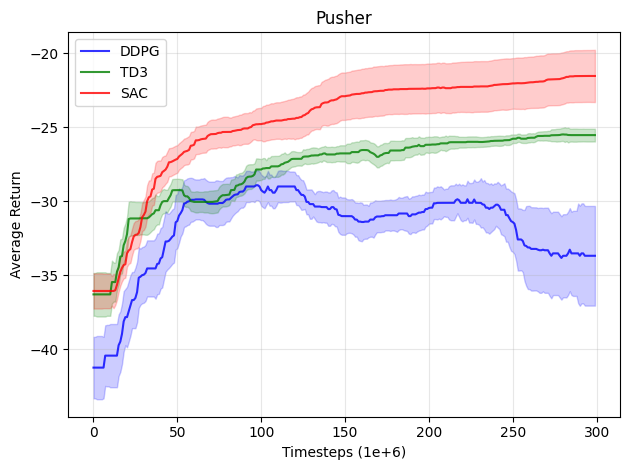 | 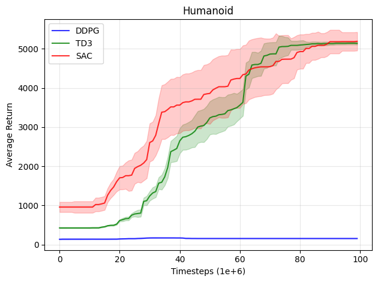 | 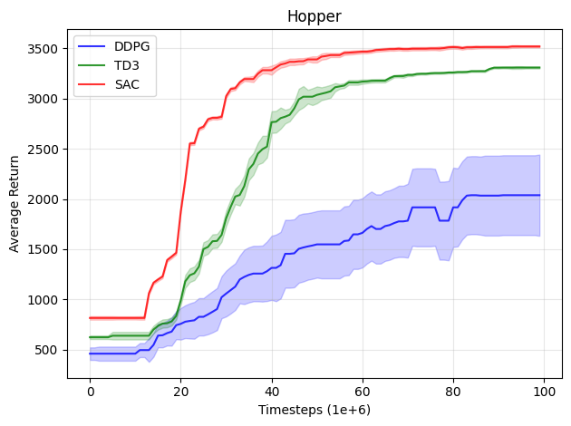 | 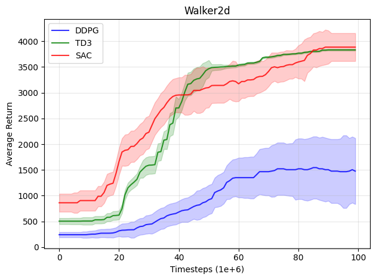 | 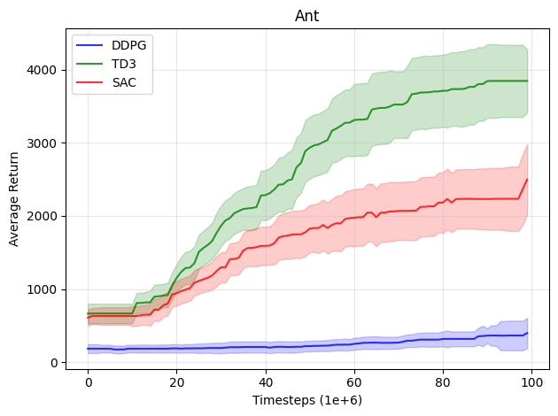 | 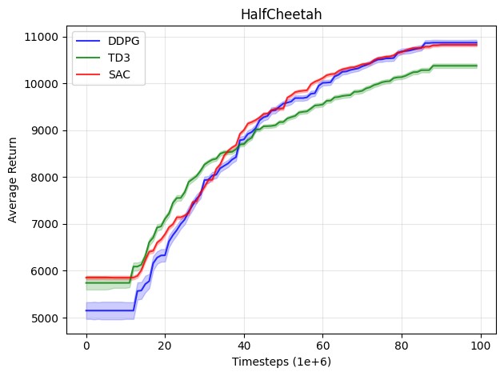 |

Figures: Learning curves for the OpenAI Gym continuous control tasks Pusher-v5, Humanoid-v5, Hopper-v5, Walker2d-v5, Ant-v5, and HalfCheetah-v5. The shaded region represents the standard deviation of the average evaluation over 3 trials (across 3 different seeds). Curves are smoothed with an average filter.

| Environment | SAC | TD3 | DDPG |
| --  | -- | -- | -- |
| Pusher-v5 |  -23.75 ± 1.71 | -25.58 ± 0.54 | -30.00 ± 0.10 |
| Humanoid-v5 |  5042.91 ± 65.42 | 5091.95 ± 18.53 | 158.16 ± 2.16|
| HalfCheetah-v5 | 8821.033 ± 1453.32 | 10272.87 ± 482.82 | 10886.83 ± 320.85 |
| Ant-v5 |  2894.23	 ± 96.81 | 4325.436361 ± 543.04 | 1074.45 ± 311.84 |
| Hopper-v5 | 3279.45 ± 49.56 | 3418.76 ± 164.38 | 2090.75 ± 352.70 |
| Walker2d-v5 | 4293.15 ± 466.90 | 3730.64 ± 191.56 | 1891.57 ± 233.16 |

*Table 1: Max Average Return over 3 trials of 1 million time steps. Maximum value for each task is bolded. ± corresponds to a single
standard deviation over trials.*

## tinyrl@Install

1. Clone the repository:

```bash
git clone https://github.com/raphaelsenn/tinyrl
```

2. Enter the repository:

```bash
cd tiny
```

3. Create and activate a conda environment:

```bash
conda create -n tinyrl python=3.11 -y
conda activate tinyrl
```

4. Install the python requirements:

```bash
pip install -r requirements.txt
```

5. Install:

```bash
pip install -e .
```

## Citations

```bibtex
@misc{lillicrap2019continuouscontroldeepreinforcement,
      title={Continuous control with deep reinforcement learning}, 
      author={Timothy P. Lillicrap and Jonathan J. Hunt and Alexander Pritzel and Nicolas Heess and Tom Erez and Yuval Tassa and David Silver and Daan Wierstra},
      year={2019},
      eprint={1509.02971},
      archivePrefix={arXiv},
      primaryClass={cs.LG},
      url={https://arxiv.org/abs/1509.02971}, 
}

@misc{fujimoto2018addressingfunctionapproximationerror,
      title={Addressing Function Approximation Error in Actor-Critic Methods}, 
      author={Scott Fujimoto and Herke van Hoof and David Meger},
      year={2018},
      eprint={1802.09477},
      archivePrefix={arXiv},
      primaryClass={cs.AI},
      url={https://arxiv.org/abs/1802.09477}, 
}

@misc{haarnoja2018softactorcriticoffpolicymaximum,
      title={Soft Actor-Critic: Off-Policy Maximum Entropy Deep Reinforcement Learning with a Stochastic Actor}, 
      author={Tuomas Haarnoja and Aurick Zhou and Pieter Abbeel and Sergey Levine},
      year={2018},
      eprint={1801.01290},
      archivePrefix={arXiv},
      primaryClass={cs.LG},
      url={https://arxiv.org/abs/1801.01290}, 
}


@misc{fujimoto2023salestateactionrepresentationlearning,
      title={For SALE: State-Action Representation Learning for Deep Reinforcement Learning}, 
      author={Scott Fujimoto and Wei-Di Chang and Edward J. Smith and Shixiang Shane Gu and Doina Precup and David Meger},
      year={2023},
      eprint={2306.02451},
      archivePrefix={arXiv},
      primaryClass={cs.LG},
      url={https://arxiv.org/abs/2306.02451}, 
}
```
